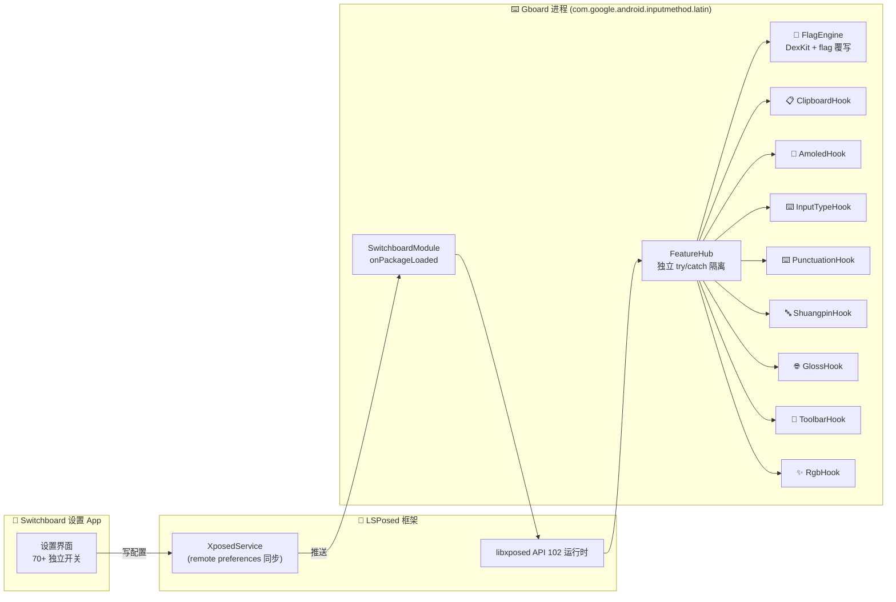

<div align="center">

# ⌨️ Switchboard

### Flip Every Switch on Gboard

*十一个 Gboard 模块的精华，接进同一块总机。*

[](#)
[](https://github.com/libxposed/api)
[](#)
[](https://github.com/LuckyPray/DexKit)
[](#-设计原则)
[](#-构建与安装)
[](#许可证)

*纯本地 hook · 无网络权限 · 无云端依赖 · 每个功能独立开关*

</div>

---

## 目录

- [为什么是 Switchboard](#为什么是-switchboard)
- [功能全景](#功能全景)
- [架构设计](#架构设计)
- [技术要点](#技术要点)
- [版本兼容矩阵](#版本兼容矩阵)
- [构建与安装](#构建与安装)
- [常见问题](#常见问题)
- [参考文献与致谢](#参考文献与致谢)
- [许可证](#许可证)

---

## 为什么是 Switchboard

Gboard 是 Android 上最强的输入法之一，但大量能力被 Google 的服务端灰度开关（Phenotype flags）和
设备锁锁住。社区已经为此写出了十几个优秀的 Xposed 模块 —— 每个解决一个痛点，装齐它们意味着
11 个常驻模块、11 套配置通道和 11 份版本失效风险。

**Switchboard 把它们合并成一个模块**，并做了三件原模块们没做的事：

1. **统一到 libxposed 新 API 102** —— 配置走框架 remote preferences，不再有
   `MODE_WORLD_READABLE` / chmod / 多通道兜底的补丁式跨进程通信[^1]
2. **100% 本地** —— 不申请 INTERNET 权限、不依赖任何云端引擎；需要外部服务的功能
   （云端 ASR 换源、在线翻译）刻意不整合
3. **一切皆开关** —— 设置页 70+ 项全部独立可关，默认值保守

## 功能全景

| 分组 | 功能 | 技术路线 | 来源 |
|---|---|---|---|
| 📋 **剪贴板** | 历史条数 / 保存天数解除限制 | DexKit 定位 → 改写 `ContentProvider#query` | [GboardHook](#参考文献) [KeyFlux](#参考文献) |
| 📋 **剪贴板** | 敏感信息保护（OTP / 卡号 / 密码框内容不入历史） | `insert` 拦截 + 输入框类型判定 | [KeyFlux](#参考文献) |
| 🚩 **Flag 引擎** | 100+ 服务端灰度开关预设（AI 写作 / Rambler 语音 / 多语言 / Emoji Kitchen / 禁遥测 / 圆角键帽 / 词学习…）+ 自定义 flag | DexKit 四路特征定位泛型读取器，按名改写返回值 | [KeyFlux](#参考文献) [FuckGboard](#参考文献) |
| 🎨 **外观** | AMOLED 纯黑背景（深色模式） | 框架 `TypedArray.getColor` 改写 | [material-expressive-black](#参考文献) |
| 🎨 **外观** | 候选栏 emoji 100% 不透明 | `AutoCenterScaleTextView#onDraw` | [FuckGboard](#参考文献) |
| ⌨️ **输入** | 密码框显示完整全键盘 | before 阶段改写 `EditorInfo.inputType` | [ForceGboardInputType](#参考文献) |
| ⌨️ **输入** | 中文九键数字页半角标点（`，。`→`,.`、标点栏→`+ − × ÷`，键面同步） | 键盘状态位 + `commitText` 双路拦截 + 键面标签改写 | [gboardtweak](#参考文献) |
| 🧰 **工具栏** | 剪贴板保险库（文本+图片）/ 粘贴 / 全选 / **选择模式** / 光标导航 / 撤销（环形缓冲+摇一摇）/ 文本快捷 / 截图自动入库 / Auto Expand 接管 | `setInputView` 注入 + `InputConnection` 包装 + SQLite | [Gboard+](#参考文献) |
| 🌐 **译词** | 候选词下方叠加译文（12 组离线词典、构词回退、DP 分词组合、语法修正、用户词表导入） | `SoftKeyDef` 签名匹配 + 纯离线词典管线 + 绘制 | [gboard-gloss](#参考文献) |
| 🔤 **双拼** | 键帽声/韵母提示（6 方案、动态提示、主字母隐藏/字号、分号键、emoji 联想） | `SoftKeyView` overlay + composing 跟踪 | [shuangpin-hints](#参考文献) [fcitx/libime](#参考文献) |
| ✨ **灯效** | 9 种 RGB 特效 + 键帽流光（可仅描边）+ 滑行轨迹 + WPM 过热 + 底光 + root 恢复原厂主题 | Canvas overlay + 键帽矩形扫描 | [gboard-RGB-studio](#参考文献) |
| ⚙️ **工具** | 一键请求作用域 / 强停 Gboard / 注入提示 | libxposed `requestScope`[^1] | — |

> 每一行都是一个独立开关，默认值保守（高风险项默认关闭）。

## 架构设计



**配置通道**：App 侧经 `XposedServiceHelper` 写入框架托管的 remote preferences，
Gboard 进程内 `getRemotePreferences("switchboard")` 只读 + 2s TTL 缓存。
相比传统 `XSharedPreferences` + chmod 方案，无需放宽文件权限，配置由框架跨进程同步[^1][^2]。

## 技术要点

<details>
<summary><b>① Flag 覆写引擎 —— 用字符串特征对抗混淆</b></summary>

Gboard 的服务端开关经由一个混淆的泛型读取器（返回 `Object`）分发。Switchboard 用 DexKit
按多路字符串特征（`"Invalid flag: "` → `"Invalid flag:"` → `"HermeticFileOverrides"` →
`"PhenotypeFlag"`）定位它[^4]，扫描结果以 `DexMethod.serialize()` 按 Gboard `versionCode`
缓存 —— 版本更新自动重扫。

flag 名从混淆对象的 `a` 字段读取（失败沿继承链找首个 String 字段兜底），
`*_language_tags / _locales / _countries` 后缀自动映射 `"*"` 实现全语言解锁。
预设表整合自 KeyFlux（70+ flag）与 FuckGboard（Rambler 27 项、Writing Tools 27 项、
圆角键帽 9 项、词学习 29 项）[^5][^6]。

</details>

<details>
<summary><b>② 三层防版本失效策略</b></summary>

| 层级 | 手段 | 采用者 |
|---|---|---|
| 动态定位 | DexKit 字符串特征 + versionCode 缓存 | Flag 引擎、剪贴板、保存时长 |
| 只用稳定 API | 仅 hook 框架层（`InputMethodService` / `TypedArray` / `EditorInfo`） | AMOLED、密码框键盘、工具栏、RGB |
| 多版本候选表 | 混淆类名按版本枚举 + `LatinPrimeKeyboard` 静态字段扫描兜底 | FuckGboard 路线 flag 类 |

任一子系统失效只影响自身（`FeatureHub` 独立 try/catch），不影响其余功能。

</details>

<details>
<summary><b>③ 纯本地译词管线</b></summary>

12 组离线词典（CC-CEDICT / JMdict / FreeDict 预处理为 gzip TSV，按行索引二分查找）
→ 精确词表 → 构词回退（`X不Y` 可能补语）→ DP 最小代价分词 + 语法组合 → 否定/助动词
修正 → 4096 条 LRU 缓存[^10]。方案数据来自 fcitx/libime 的双拼表（LGPL-2.1）[^15]。
全程不联网。

</details>

<details>
<summary><b>④ 键帽级 hook（双拼 / 译词 / 九键键面）</b></summary>

共同锚点是未混淆的 `com.google.android.libraries.inputmethod.widgets.SoftKeyView` 与
`...metadata.SoftKeyDef`。译词按「首参数为 `SoftKeyDef` 的非静态方法」签名匹配绑定事件
（18.4=`r`、18.5=`s` 不依赖名字）[^10]；双拼监听 `SharedPreferencesImpl.getString("pinyin_scheme")`
零混淆读取方案、用 `InputConnection` composing 文本驱动动态提示[^12]；提示均为
`View.getOverlay()` 上的 Drawable，不触碰 Gboard 自绘文本。

</details>

## 版本兼容矩阵

`compat-test/scan.py` 对任意 Gboard APK 做静态 DEX 扫描，预判每个 hook 锚点是否存在
（不执行 APK）：

| 锚点 | 功能 | Gboard 16.6.3 | 17.8.3-beta |
|---|---|:---:|:---:|
| `"Invalid flag: "` 特征 | Flag 引擎 | ✓ | ✓ |
| `ClipboardContentProvider` | 剪贴板解除 | ✓ | ✓ |
| `SoftKeyView` / `SoftKeyDef` | 双拼 · 译词 | ✓ / ✗* | ✓ / ✓ |
| `LatinKeyboardWithNumberMode` + `aekp` | 九键标点 | ✓ / ✗ | ✓ / ✓ |
| retention 特征 | 保存天数 | ✗ | ✗ |

\* 16.6.3 无 `SoftKeyDef`，双拼/译词自动回退 TextView 标签路径。retention / `cF` / `cz` /
`aekp.q` 为 18.5.4 才有的混淆名——矩阵如实反映版本漂移，对应功能自动降级。
**扫描器 v2 解析 class_data 定义级方法/字段表**（非仅字符串池），对新版本 Gboard 秒级出矩阵，
哨兵 workflow 每周自动比对基线 —— 见 [compat-test](compat-test/)。

实测版本锚点（来自上游模块源码注释）：九键标点 = 18.5.4[^9]，FuckGboard flag 类 = 17.8.4–18.5.2[^6]。

## 构建与安装

```bash
git clone https://github.com/uuapi/switchboard
cd switchboard
./gradlew :app:testDebugUnitTest   # JVM 单元测试（词典/语法/标点/敏感规则）
./gradlew :app:assembleDebug       # 或 assembleRelease（已用 debug key 签名可直接安装）
```

CI（`build.yml`）在每次 push 时跑单测 + 双构建，打 `v*` tag 自动发 Release；
`monitor.yml` 每周一自动拉取最新 Gboard、刷新锚点矩阵、检测到漂移自动开 issue
（runner 在海外，可直达 APKPure，正好补齐本地网络盲区）。

- 依赖：JDK 21 · Android SDK 36 · AGP 8.9（Gradle wrapper 自动就位）
- libxposed API 102 以本地 jar 形式编译（`app/libs/`，Maven 上 `interface:102` AAR 元数据要求
  尚未公开发布的 SDK 37，参照上游 libxposed 模块的做法直接对 jar 编译）

**安装**：APK → LSPosed 启用 → 打开 Switchboard 点「请求 Gboard 作用域」（API 102 `requestScope`）
→ 强停 Gboard → 设置页按需开关。

## 常见问题

<details>
<summary>Gboard 更新后某些功能失效了？</summary>
跑 <code>compat-test/scan.py</code> 对新 APK 出矩阵，确认是哪个锚点消失；对应开关关掉即可，
其余功能不受影响（子系统互相隔离）。Flag 引擎与剪贴板有 DexKit 自适应，通常无需动作。
</details>

<details>
<summary>为什么没有语音识别换源 / 在线翻译？</summary>
刻意移除。Switchboard 坚持 100% 本地：不申请 INTERNET 权限、不把输入内容交给任何云端引擎。
需要这些功能请使用上游 <a href="#参考文献">gboard-voice-bridge</a> / <a href="#参考文献">gboard-gloss</a>。
</details>

<details>
<summary>密码框完整键盘安全吗？</summary>
该功能默认关闭：启用后 Gboard 有机会记录密码框输入（隐身模式可能被绕过）。请自行权衡。
</details>

<details>
<summary>多进程会重复 hook 吗？</summary>
不会。hook 按进程幂等安装，用户可感操作（Toast）仅限首进程。
</details>

## 参考文献

Switchboard 站在以下项目的肩膀上，特此致谢：

| # | 项目 | 用途 |
|---|---|---|
| [1] | [LSPosed/LSPosed](https://github.com/LSPosed/LSPosed) | 运行框架 |
| [2] | [libxposed/api](https://github.com/libxposed/api) · [libxposed/service](https://github.com/libxposed/service) | 新 API 102 / remote preferences / `requestScope` |
| [3] | [LuckyPray/DexKit](https://github.com/LuckyPray/DexKit) | 运行时 DEX 特征定位 |
| [4] | [chenyue404/GboardHook](https://github.com/chenyue404/GboardHook) ★142 | 剪贴板限制解除思路、DexKit 查询与缓存策略 |
| [5] | [NawafCode/KeyFlux](https://github.com/NawafCode/KeyFlux) | flag 预设全表、敏感剪贴板规则、设置页注入思路 |
| [6] | [EraserCN/FuckGboard](https://github.com/EraserCN/FuckGboard) | Rambler/WritingTools/圆角键帽/词学习 flag 表、多版本混淆类候选、LatinPrimeKeyboard 兜底 |
| [7] | [hxreborn/gboard-material-expressive-black](https://github.com/hxreborn/gboard-material-expressive-black) | AMOLED `TypedArray` 方案、libxposed 新 API 工程范式 |
| [8] | [kooritea/ForceGboardInputType](https://github.com/kooritea/ForceGboardInputType) | `EditorInfo` 输入类型改写规则 |
| [9] | [RibosomeK/gboardtweak](https://github.com/RibosomeK/gboardtweak) | 九键数字页状态位、commitText 双路拦截、键面改写 |
| [10] | [ziyuw-Plank/gboard-gloss](https://github.com/ziyuw-Plank/gboard-gloss) | 词典资产与离线翻译管线、`SoftKeyDef` 签名匹配、横幅 |
| [11] | [kvmy666/Gboard (Gboard+)](https://github.com/kvmy666/Gboard) | 工具栏/保险库/撤销/光标、纯框架层 hook 范式 |
| [12] | [rikumi/gboard-shuangpin-hints](https://github.com/rikumi/gboard-shuangpin-hints) (LGPL-2.1) | 双拼方案引擎、`HintDrawable` 绘制、DeferredHooks 思路 |
| [13] | [m4mental/gboard-RGB-studio](https://github.com/m4mental/gboard-RGB-studio) | 灯效/键帽流光/恢复主题思路 |
| [14] | [fcitx/libime](https://github.com/fcitx/libime) (LGPL-2.1) | 双拼方案数据（`shuangpindata.h`） |
| [15] | CC-CEDICT · JMdict · FreeDict | 离线词典数据源（经 gboard-gloss 预处理） |

## 许可证

- Switchboard 原创代码：**MIT**
- 移植自 [gboard-gloss](https://github.com/ziyuw-Plank/gboard-gloss) 与
  [gboard-shuangpin-hints](https://github.com/rikumi/gboard-shuangpin-hints) 的文件
  （`hook/gloss/*`、`hook/shuangpin/*`，文件头有标注）：沿用其 **LGPL-2.1**，
  版权声明保留于文件头
- 双拼方案数据派生自 fcitx/libime（LGPL-2.1，© 2011–2020 CSSlayer）

## 免责声明

本项目仅供学习研究与个人设备自定义使用。使用本模块产生的任何输入数据均留在本地 ——
但请自行评估各开关的安全权衡（如密码框全键盘）。与 Gboard 的服务端行为相关的 flag 覆写
可能随 Google 侧调整而变化。
